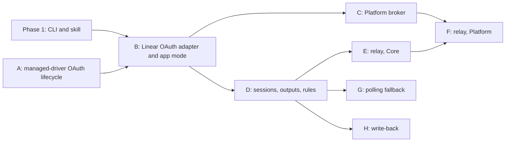

# Linear agent app integration design (phases 2 to 4)

Ficus becomes a Linear agent app. People delegate Linear issues to "Ficus" or @mention it, squad event rules decide what happens, and Ficus reports progress, questions and the delivery pull request back into the Linear agent session. This document is the implementation-ready design for phases 2 to 4 of the Linear agent integration roadmap. Phase 1 (a pinned `linear` CLI and a `linear` agent skill) is implemented separately and is a dependency of phase 2.

## Contents

1. [Decisions already made](#1-decisions-already-made)
2. [Verified Linear platform facts](#2-verified-linear-platform-facts)
3. [Current state in Core and Platform](#3-current-state-in-core-and-platform)
4. [Phase 2: the Linear agent app connection](#4-phase-2-the-linear-agent-app-connection)
5. [Phase 3: agent session events and event rules](#5-phase-3-agent-session-events-and-event-rules)
6. [Phase 4: progress write-back](#6-phase-4-progress-write-back)
7. [Cross-cutting concerns](#7-cross-cutting-concerns)
8. [Implementation streams](#8-implementation-streams)
9. [Recorded design decisions](#9-recorded-design-decisions)
10. [Unverified assumptions](#10-unverified-assumptions)

## 1. Decisions already made

These were settled by the product owner on 2026-11-19 before this design was written and are not reopened here. The product owner's answers to the questions this design raised are recorded in section 9 and applied throughout.

1. **Identity.** Ficus is a Linear OAuth agent app installed with `actor=app` and the scopes `app:assignable` and `app:mentionable`. It appears in the workspace as its own member, "Ficus". Personal API-key connections stay supported, mainly for self-hosted instances.
2. **Write-back.** Ficus posts progress and attaches the pull request to the Linear issue. Ficus never moves issue workflow states; Linear's GitHub integration does that. This deliberately departs from Linear's best-practice recommendation that an agent moves a delegated issue to the first `started` state ([best practices](https://linear.app/developers/agent-best-practices)).
3. **What delegation does.** A configurable squad event rule decides, exactly like GitHub issue assignments in `packages/shared/src/squad-event-rules.ts`. Defaults mirror GitHub: delegation or assignment to the connected account or app → `notify-manager` (`connected-account`); comments and mentions → `notify-manager` (`assigned-or-mentioned`). Squads can switch a rule to `start-workstream`, `notify-consultant` or `ignore`.

## 2. Verified Linear platform facts

Checked against Linear's developer documentation and the published GraphQL schema (`packages/sdk/src/schema.graphql` in `linear/linear`, master) on 2026-11-19. Section 10 lists what is still unverified.

| Topic              | Fact                                                                                                                                                                                                                                                                                                                                                                                                 | Source                                                                                                                                     |
| ------------------ | ---------------------------------------------------------------------------------------------------------------------------------------------------------------------------------------------------------------------------------------------------------------------------------------------------------------------------------------------------------------------------------------------------- | ------------------------------------------------------------------------------------------------------------------------------------------ |
| App install        | `actor=app` on the authorization URL installs the app for the whole workspace and needs a workspace admin. `actor=app` cannot request `admin`.                                                                                                                                                                                                                                                       | [Agents](https://linear.app/developers/agents)                                                                                             |
| App scopes         | `app:assignable` lets users delegate issues to the app (it does not enable ordinary assignment). `app:mentionable` lets users mention it.                                                                                                                                                                                                                                                            | [OAuth 2.0](https://linear.app/developers/oauth-2-0-authentication)                                                                        |
| Other scopes       | `read` is always present. `write` is broad. `issues:create` covers creating and updating issues and their attachments. `comments:create` covers creating comments.                                                                                                                                                                                                                                   | [OAuth 2.0](https://linear.app/developers/oauth-2-0-authentication)                                                                        |
| Authorize URL      | `GET https://linear.app/oauth/authorize` with `client_id`, `redirect_uri`, `response_type=code`, comma-separated `scope`, `state`, `actor`, optional `prompt=consent`. PKCE is supported but optional for confidential clients.                                                                                                                                                                      | [OAuth 2.0](https://linear.app/developers/oauth-2-0-authentication)                                                                        |
| Token exchange     | `POST https://api.linear.app/oauth/token`, `application/x-www-form-urlencoded`, `grant_type=authorization_code`, `code`, `redirect_uri`, `client_id`, `client_secret`. Response: `access_token`, `token_type: Bearer`, `expires_in` (86399), `scope`, `refresh_token`. No identity in the response.                                                                                                  | [OAuth 2.0](https://linear.app/developers/oauth-2-0-authentication)                                                                        |
| Token lifetime     | Authorization-code access tokens last 24 hours for both `user` and `app` actors. Every OAuth app was migrated to refresh tokens on 2026-04-01.                                                                                                                                                                                                                                                       | [OAuth 2.0](https://linear.app/developers/oauth-2-0-authentication)                                                                        |
| Refresh            | `grant_type=refresh_token`, client authentication by HTTP Basic or form fields. Each refresh returns a new access and refresh token pair. A refresh token expires 30 days after issue. If a successful refresh response is lost, retrying with the same refresh token within 30 minutes recovers the replacement pair.                                                                               | [OAuth 2.0](https://linear.app/developers/oauth-2-0-authentication)                                                                        |
| Reinstall          | Re-running authorization with `update_scopes_on_existing_token=true` replaces the installation's tokens. A plain repeat of the install flow does not update an existing installation.                                                                                                                                                                                                                | [Actor authorization](https://linear.app/developers/oauth-actor-authorization)                                                             |
| Revoke             | `POST https://api.linear.app/oauth/revoke` with form field `token` and optional `token_type_hint`. `200` revoked, `400` cannot revoke (for example already revoked), `401` cannot authenticate.                                                                                                                                                                                                      | [OAuth 2.0](https://linear.app/developers/oauth-2-0-authentication)                                                                        |
| Identity           | The app has a unique user ID per workspace (`viewer { id }`); store it with the token. `User.app` is true for app users.                                                                                                                                                                                                                                                                             | [Agents](https://linear.app/developers/agents), schema                                                                                     |
| API auth           | OAuth tokens are sent as `Authorization: Bearer <token>`.                                                                                                                                                                                                                                                                                                                                            | [OAuth 2.0](https://linear.app/developers/oauth-2-0-authentication)                                                                        |
| Delegation         | Assigning an issue to the app sets `Issue.delegate`, not `assignee`. Issue webhooks carry `delegateId`/`delegate`, with the previous value in `updatedFrom`.                                                                                                                                                                                                                                         | [Agents](https://linear.app/developers/agents), schema `IssueWebhookPayload`                                                               |
| App webhooks       | An OAuth app has one webhook URL for every workspace it is installed in, signed with the app's signing secret. Categories include `AgentSessionEvent`, `AppUserNotification`, `PermissionChange`, `Issue`, `Comment`; `OAuthApp` `revoked` is sent on uninstall.                                                                                                                                     | [Webhooks](https://linear.app/developers/webhooks), schema `WebhookResourceType`                                                           |
| Webhook delivery   | Headers `Linear-Delivery` (UUID), `Linear-Event`, `Linear-Signature` (hex HMAC-SHA256 of the raw body), `Linear-Timestamp`. Body `webhookTimestamp` (ms); Linear recommends rejecting anything older than 60 seconds. The receiver must answer `200` within 5 seconds; failures are retried 3 times after 1 minute, 1 hour and 6 hours, and a webhook that keeps failing may be disabled.            | [Webhooks](https://linear.app/developers/webhooks)                                                                                         |
| Sessions           | A delegation or mention creates an `AgentSession` and sends `AgentSessionEvent` `created`; later user messages arrive as `prompted` with the text in `agentActivity.body`. Payloads carry `organizationId`, `appUserId`, `oauthClientId`, `agentSession` (`id`, `issueId`, `issue`, `commentId`, `creatorId`, `url`, `status`), and on `created` `promptContext`, `previousComments` and `guidance`. | [Agent interaction](https://linear.app/developers/agent-interaction), schema `AgentSessionEventWebhookPayload`                             |
| Acknowledgment     | After `created`, the agent must send an activity or set an external URL within 10 seconds or the session is shown as unresponsive. Activities can follow for 30 minutes before the session is marked `stale`; another activity recovers it.                                                                                                                                                          | [Agent interaction](https://linear.app/developers/agent-interaction), [best practices](https://linear.app/developers/agent-best-practices) |
| Activities         | `agentActivityCreate(input: { agentSessionId, content, id?, ephemeral?, signal?, signalMetadata? })`. Content types `thought`, `action` (`action`, `parameter`, optional `result`), `elicitation`, `response`, `error`. Only `thought` and `action` may be ephemeral. `id` accepts a client-supplied UUID v4. Bodies accept up to 250,000 characters.                                                | schema `AgentActivityCreateInput`                                                                                                          |
| Signals            | `stop` (from users on `prompt` activities: halt immediately, then send a final `response` or `error`), `auth` and `select` (on `elicitation`; `select` takes 1 to 100 options), `continue` (on a `response` when more work follows). Users may answer a `select` elicitation in free text.                                                                                                           | [Signals](https://linear.app/developers/agent-signals), schema `AgentActivitySignal`                                                       |
| Session state      | `pending`, `active`, `awaitingInput`, `error`, `complete`, `stale`, `stopping`, derived from the last activity. `response` normally completes the turn.                                                                                                                                                                                                                                              | schema `AgentSessionStatus`, `AgentActivityCreateInput`                                                                                    |
| Session update     | `agentSessionUpdate(id, input: { addedExternalUrls, removedExternalUrls, externalUrls, plan, summary })`. Adding a GitHub pull request URL to `externalUrls` tells Linear the agent opened a pull request. Plans are a technology preview.                                                                                                                                                           | [Agent interaction](https://linear.app/developers/agent-interaction), schema `AgentSessionUpdateInput`                                     |
| Proactive sessions | `agentSessionCreateOnIssue` and `agentSessionCreateOnComment` create a session without a delegation or mention.                                                                                                                                                                                                                                                                                      | [Agent interaction](https://linear.app/developers/agent-interaction)                                                                       |
| Comments           | When an agent emits `response`, `elicitation` or `error`, Linear also creates a comment in the session thread.                                                                                                                                                                                                                                                                                       | [Best practices](https://linear.app/developers/agent-best-practices)                                                                       |
| Notifications      | `AppUserNotification` webhooks report `issueMention`, `issueCommentMention`, `issueAssignedToYou`, `issueUnassignedFromYou`, `issueNewComment` and others for the app user.                                                                                                                                                                                                                          | [Best practices](https://linear.app/developers/agent-best-practices)                                                                       |
| Permissions        | `PermissionChange` `teamAccessChanged` carries `organizationId`, `appUserId`, `oauthClientId`, `canAccessAllPublicTeams`, `addedTeamIds`, `removedTeamIds`.                                                                                                                                                                                                                                          | [Best practices](https://linear.app/developers/agent-best-practices)                                                                       |
| Attachments        | `attachmentLinkGitHubPR(issueId, url, linkKind?: closes \| contributes \| links, title?)` uses the workspace's GitHub integration when present. Attachment URLs are idempotent per issue: creating the same URL again updates the existing attachment.                                                                                                                                               | [Attachments](https://linear.app/developers/attachments), schema `Mutation.attachmentLinkGitHubPR`                                         |
| Polling surface    | `agentSessions(orderBy: updatedAt)`, `agentActivities(filter: { type, createdAt })` and `notifications(filter: { createdAt, type })` exist at the query root. Linear discourages polling.                                                                                                                                                                                                            | schema, [rate limiting](https://linear.app/developers/rate-limiting)                                                                       |
| Rate limits        | OAuth apps: 5,000 requests and 2,000,000 complexity points per hour per app user, doubled on Business and five times on Enterprise, plus dynamic increases for `actor=app` installs. API keys: 2,500 requests and 3,000,000 points per hour per user. Exceeding returns HTTP 429 with `RATELIMITED` and `Retry-After`.                                                                               | [Rate limiting](https://linear.app/developers/rate-limiting)                                                                               |

## 3. Current state in Core and Platform

Core (`apps/core/src/services/integrations/linear/`):

- `plugin.ts`: the `linear` plugin, `authorization: { kind: 'manual' }`, configuration `{ version: 1 }`, credential a raw API key string sent verbatim as `Authorization`. `lifecycle: { refresh: false, revoke: false }`. Phase 1 adds the `linear` binary, `LINEAR_API_KEY`, `LINEAR_IGNORE_ENV_FILE` and `LINEAR_GRAPHQL_ENDPOINT` to `execution`, and the `linear` skill.
- `webhook.ts`, `webhook-settings.ts`: one per-instance organization webhook at `POST /api/webhooks/linear` (`apps/core/src/routes/webhooks.ts`), secret in `__integration-webhook:linear`. No `webhookTimestamp` check.
- `ingress.ts`: `routeLinearEvent` normalizes one fact, then for every squad with an enabled Linear assignment runs a live `IssueAccess` probe with that squad's credential (`canReceiveLinearEvent`) before `publishIntegrationOutputs`.
- `outputs.ts` and `packages/shared/src/event-predicate-catalog.ts` (`linearOutputCatalog`): `issue.assigned`, `issue.unassigned`, `issue.updated`, `issue.comment`.
- `packages/shared/src/squad-event-rules.ts`: the only Linear default is `issue.assigned` → `notify-manager`. `matchesAudience` treats every non-GitHub audience as "no restriction"; Linear's account binding lives in ingress instead.
- `tracked-resources/linear.ts`: issues tracked on work streams subscribe to the four outputs and deliver to the delivery owner.
- No write-back of any kind, no polling, no relay.

Reusable infrastructure:

- OAuth adapters: `packages/shared/src/oauth-providers/{types,registry}.ts`, `notion/`, `slack/`, `github/`, test `fake/adapter.ts`.
- `apps/core/src/services/integrations/plugin.ts`: `OAuth2Authorization` (with `resolveGrantIdentity` and `refreshInvalidatesPreviousTokens`), and `ManualCredentialDriver.managed`, a same-provider OAuth install offered next to manual credential entry (used by Slack's "Add to Slack"). `oauth-plugin-view.ts` turns a manual plugin's managed driver into an OAuth view, but only `authorization/service.ts` and the revocation worker use that view.
- Authorization flow: `authorization/service.ts`, `connection-authorizer.ts`, `refresh-service.ts`, `refresh-worker.ts`, `revocation-worker.ts`, `client-credentials.ts` (self-hosted OAuth app settings for `notion` and `github`), `authority.ts` (`local` vs `platform_broker`). Routes in `apps/core/src/routes/integrations.ts`: `GET|PUT /providers/:provider/oauth-app`, `POST /providers/:provider/authorization/{start,callback,complete}`.
- Hosted relay consumer: `relay/runner.ts` (`HostedIntegrationRelayRunner`), `relay/slack-runtime.ts` (2-second pull cadence, revision-fenced managed connection lookup).
- Polling: `event-polling-runner.ts`, `db-event-polling-cursor-store.ts`, `db-event-polling-dispatch-store.ts`, `EventPollingCapability` in `types.ts`.
- Durable stream history: `work_stream_flow_transitions` (versioned per stream), `agent_question_work_stream_origins`, `services/agents/questions.ts` (`answerAgentQuestion`, `resolveAgentQuestionWithRelayedAnswer`). A debounced projection precedent: `services/push/live-activity.ts`.

Platform (`ficus-platform`, which consumes Core's `@ficus/shared` as a pinned tarball):

- OAuth broker: `apps/platform/src/routes/oauth-broker.ts` mounted at `/api/oauth-broker` with `POST /:provider/{start,redeem,refresh,revoke}` and `GET /:provider/callback`; the adapter comes from `getOAuthProviderAdapter`. Client credentials per provider in `services/oauth-broker/client-credentials.ts`. Callback `<PLATFORM_BASE_URL>/api/oauth-broker/<provider>/callback`.
- Integration relay: `apps/platform/src/routes/integration-relay.ts` mounted at `/api/integration-relay`, `services/integration-relay/{store,github-provider,slack-provider}.ts`. Public signed `POST /<provider>/webhook`; tenant-authenticated `status`, `subscribe`, `unsubscribe`, `pull`, `ack`. Events are retained 72 hours (`RELAY_EVENT_TTL_MS`), leased for 120 seconds, pulled in batches of 10. Slack proves the token at subscribe time and compares a token hash at pull time.
- Wire schemas: `packages/shared/src/integration-relay/protocol.ts` in Core (`RELAY_PROVIDER_KEYS = ['github', 'slack']`).

## 4. Phase 2: the Linear agent app connection

### 4.1 One plugin with two connection modes

Keep a single `linear` plugin. An API-key connection and an app connection are two modes of the same provider:

```ts
// apps/core/src/services/integrations/linear/plugin.ts
authorization: { kind: 'manual', managed: linearAppDriver }
```

Rationale: squad event rules (`metadata.integrationRules.linear`), team routing (`metadata.linear`), tracked resources (`integration: 'linear'`), outputs, the Activity family, `ficus integration exec linear`, the `linear` CLI and skill, and the per-squad assignment (`getAssigned(squadId, 'linear')`) are all keyed by provider. A second provider key (for example `linear-app`) would split every one of those, give squads two Linear rule lists, and need a migration to move a squad from one to the other. The managed-driver shape already exists for exactly this case; it only lacks lifecycle support (4.2).

Rejected alternative: a separate `linear-app` OAuth2 plugin. It gets refresh, revocation and execution for free, but duplicates rules, routing, tracked resources and the CLI binding, and makes "switch this squad from a personal key to the app" a cross-provider migration.

A squad still has exactly one assigned Linear connection. A squad assigned an app connection gets app behavior (agent sessions, write-back, the CLI acting as "Ficus"); a squad assigned an API-key connection keeps today's behavior plus the new outputs that apply to it.

### 4.2 Core prerequisite: per-connection OAuth lifecycle for managed drivers

Today only plugins whose top-level `authorization.kind` is `oauth2` are refreshed, revoked, expiry-checked at execution time and authority-fenced. Add an explicit per-connection authorization kind so a manual plugin's managed-driver connections get the full OAuth lifecycle:

- Schema (`apps/core/src/db/schema.ts`, `integration_connections`): new column `authorization_kind varchar(16) not null default 'manual'`, check `in ('manual', 'oauth2')`. Generated migration backfills `'oauth2'` for rows whose provider plugin is an OAuth2 plugin (`github`, `notion`) and for `slack` rows with `client_authority = 'platform_broker'`.
- `connection-authorizer.ts` (`installAuthorizedMaterial`) writes `authorization_kind = 'oauth2'`; manual credential writes keep `'manual'`.
- New helper `connectionOAuthView(plugin, connection)` in `oauth-plugin-view.ts`: returns `oauthPluginView(plugin, connection.clientAuthority)` when `connection.authorizationKind === 'oauth2'`, else `undefined`.
- Replace the plugin-level checks with the helper in: `authorization/refresh-service.ts` (line 117), `runtime.ts` (refresh worker `oauthProviderKeys` at line 339 also includes plugins with a managed driver whose `lifecycle.refresh` is true; `listRefreshCandidates` filters `authorization_kind = 'oauth2'`; lines 382, 554 to 580), `authorization/connection-authorizer.ts` (lines 355, 376, 614), `execution.ts` (lines 49 and 56: authority fence and access-token expiry), `projection/protected-env.ts`, `projection/load-effective-toolchain.ts`, `projection/agent-refs.ts`, `projection/reconciler.ts`, `entities/agent-runners/base.ts`.
- Plugin `lifecycle` stays plugin-wide; the refresh and revocation workers only act on `oauth2` connections.
- Execution resolvers receive the codec that matches the connection. `IntegrationExecutionDeclaration` keeps one `environment` map; a plugin with two modes parses a credential union (4.4).

Slack's managed connections become `oauth2` rows; its `lifecycle.refresh` stays `false`, so behavior is unchanged. A Slack regression test is part of the acceptance criteria.

### 4.3 Linear OAuth adapter (`packages/shared/src/oauth-providers/linear/`)

New files, following `notion/` and `github/`:

- `client.ts`: `LinearOAuthClient` with injected `fetch`, bounded bodies (64 KiB), 10-second timeout, `redirect: 'error'`.
  - `buildAuthorizationUrl({ clientId, redirectUri, state })` → `https://linear.app/oauth/authorize?client_id=…&redirect_uri=…&response_type=code&scope=read,issues:create,comments:create,app:assignable,app:mentionable&state=…&actor=app&prompt=consent`. The scope list is one exported constant, `LINEAR_APP_SCOPES`.
  - `exchangeCode` and `refresh`: form-encoded `POST https://api.linear.app/oauth/token`, client authentication with HTTP Basic. Parse `access_token`, `refresh_token`, `expires_in` (bounded to one year) and `scope` (a space- or comma-separated string, or an array for pre-2023 apps) into `{ accessToken, refreshToken, expiresAt, scopes }`.
  - `revoke({ token })`: form-encoded `POST https://api.linear.app/oauth/revoke` with `token` and `token_type_hint=access_token`. `400` maps to `already_revoked`, `401` to `invalid_auth`; the Platform broker already treats both as the goal state (`REVOKE_GOAL_STATE_CODES`).
  - `identity({ accessToken })`: `query FicusLinearIdentity { viewer { id name app } organization { id name urlKey } }` with `Authorization: Bearer`. Rejects a token whose `viewer.app` is not `true`, so a user-actor token can never be stored as an app connection.
- `config.ts`: `LinearAppConfiguration` and `parseLinearAppConfiguration` (exact keys, bounded strings): `{ version: 2, mode: 'app', organizationId, organizationName, organizationUrlKey, appUserId, appUserName, scopes }`. `safeLinearAppConfiguration` drops nothing secret (none is stored there) but omits `scopes` from the catalog DTO.
- `adapter.ts`: `linearAdapter: OAuthProviderAdapter` with `key: 'linear'`, `authorizeHosts: ['linear.app']`. `exchangeCode` and `refresh` return `{ tokens, configuration: null, displayName: 'Linear' }`, like GitHub: the token pair is persisted before any fallible identity call. `classifyLinearOAuthError` maps `invalid_grant` and `invalid_client` to non-retryable codes, HTTP 429 to `rate_limited` with `providerRateLimited` and `retryAfterSeconds`, network and 5xx to retryable codes.
- `registry.ts`: register `['linear', linearAdapter]` and export `classifyLinearOAuthError`.
- `fake/adapter.ts`: add `fakeLinearGrant()` beside `fakeGrant()`; `createFakeAdapter(script, 'linear')` already takes the key.

### 4.4 The app driver and the credential union (`apps/core/src/services/integrations/linear/`)

`plugin.ts`:

```ts
type LinearConfiguration = { version: 1 } | LinearAppConfiguration
type LinearCredential = { kind: 'api-key'; key: string } | { kind: 'oauth'; bundle: OAuthCredentialBundleV1 }

const linearAppDriver: ManagedOAuthDriver<LinearAppConfiguration> = {
  kind: 'oauth2',
  adapter: 'linear',
  authorities: ['platform_broker', 'local'],
  // One app connection per Linear workspace: reconnecting the same workspace updates it.
  identity: (configuration) => ({ organizationId: configuration.organizationId }),
  // Linear rotates the pair on every refresh; persist before validating.
  refreshInvalidatesPreviousTokens: true,
  async resolveGrantIdentity(credential) {
    /* identity query → configuration, displayName `${organizationName} (Ficus app)` */
  },
  async validate({ configuration, credential }) {
    /* viewer.id === appUserId && viewer.app && organization.id === organizationId, else workspace_identity_mismatch */
  },
}
```

- `connection.parseConfiguration` accepts both `{ version: 1 }` (unchanged API-key shape) and the version 2 app shape.
- `connection.credential`: parse a stored value as an OAuth bundle when it is a JSON object that `parseOAuthCredential` accepts, otherwise as a raw API key (a Linear key is never JSON). `serialize` writes the raw key unchanged for API-key connections, so existing secrets are not rewritten.
- `linearAuthorization(credential)`: `key` verbatim for API keys, `Bearer <accessToken>` for app tokens. `linearQuery` takes this header value instead of the raw credential; every Core caller (`ingress.ts`, `tracked-resources/linear.ts`, memory search) goes through it.
- `execution.environment.LINEAR_API_KEY`: `({ credential }) => linearAuthorization(credential)`. Phase 1 established that schpet/linear-cli sends `LINEAR_API_KEY` verbatim as the `Authorization` header, so app connections get `Bearer <token>` with no CLI change (to be confirmed live, section 10). `LINEAR_IGNORE_ENV_FILE` and `LINEAR_GRAPHQL_ENDPOINT` are unchanged.
- `lifecycle: { refresh: true, revoke: true }`. With 4.2 these act only on `oauth2` connections.
- `sandbox.protectedBindings`: add `LINEAR_ORGANIZATION_URL_KEY` from configuration `organizationUrlKey`, so the skill can say which workspace the CLI acts in. API-key connections have no such field; the binding is omitted for them.
- `presentation.connectionMode` stays `credential`. The Integrations page (`apps/web`) shows "Install Ficus in Linear" next to "Add API key" whenever `GET /api/integrations/providers/linear/oauth-app` reports `configured` (always on hosted instances, after 4.6 on self-hosted ones).

Refresh behavior: `refresh-service.ts` refreshes proactively ahead of the 24-hour expiry (the existing proactive window), so the 30-day refresh token never lapses while the connection is healthy. A failed refresh with `invalid_grant` moves the connection to `reauthorization_required` through the existing `#reauthorization` path. The lease in `connection-lease.ts` already serializes refreshes per connection, which Linear requires ("coordinate refreshes across processes sharing an authorization"). A refresh whose response was lost is retried with the same refresh token within Linear's 30-minute recovery window by the existing retry path; no new mechanism is needed.

Revocation: deleting or replacing an app connection schedules the existing revocation job, which calls the adapter (local) or `POST /api/oauth-broker/linear/revoke` (hosted).

### 4.5 Hosted instances: the Platform OAuth broker

No new broker routes. Changes in `ficus-platform`:

- Update the vendored `@ficus/shared` tarball to a Core version that contains `oauth-providers/linear` (`vendor-lock.json`, `dependencies/`, verified with the vendor verifier; never edited by hand).
- `apps/platform/src/services/oauth-broker/client-credentials.ts`: `linear` → `LINEAR_OAUTH_CLIENT_ID`, `LINEAR_OAUTH_CLIENT_SECRET`.
- Redirect URI registered in the Linear OAuth app: `<PLATFORM_BASE_URL>/api/oauth-broker/linear/callback` (from `callbackUri()` in `routes/oauth-broker.ts`).
- `docs/wiki/platform/control-plane-ops.md` (environment table, setup section) and `scripts/setup/ficus-platform.example.yaml`.

Core already routes `platform_broker` authorization through `authorization/broker-transport.ts`; the managed driver's `authorities` includes `platform_broker`, so the hosted flow is `start` → Linear consent → Platform callback → escrow → Core `complete` → `resolveGrantIdentity` → install.

### 4.6 Self-hosted instances: their own Linear OAuth app

- `authorization/client-credentials.ts`: `SELF_HOSTED_OAUTH_APP_KEY.linear = '__integration-oauth-app:linear'`, stored as `{ version: 1, clientId, clientSecret, webhookSecret, capabilitiesAcknowledged: true }`. Replace `requireNotion` with an allowlist of `notion` and `linear`. `getOAuthAppSettings('linear')` returns the callback URL (`resolveOAuthCallbackUrl()` in `authorization/public-url.ts`), the app webhook URL (`/api/webhooks/linear-app`, 5.1), and the required capabilities. Secrets are never returned.
- Routes: the existing `GET|PUT /api/integrations/providers/linear/oauth-app` and `POST /providers/linear/authorization/{start,callback}`.
- Web: `apps/web` Integrations → Linear card gains an "Agent app" section (client ID, client secret, webhook signing secret, callback and webhook URLs to copy into Linear, and the install button).
- The operator's app can have any name; it appears in Linear under that name.

### 4.7 Coexistence and migration of API-key connections

- Existing API-key connections, their `{ version: 1 }` configuration, raw-key secrets, legacy import (`legacy-import.ts`) and the organization webhook (`webhook-settings.ts`) are untouched.
- Both modes can exist on one instance; a squad picks one connection. Moving a squad from a key to the app is a normal reassignment; tracked issues keep matching because tracked subscriptions match on `issue.id` and connection IDs are only pinned for new entries.
- Display names stay unique per provider (`uq_integration_connections_provider_display_name`); app connections are named `<Workspace name> (Ficus app)`.
- On upgrade, new default event rules (5.5) appear only for squads with no stored `integrationRules.linear`, as the existing `effectiveSquadEventRules` contract requires. The rules editor offers "Add recommended Linear rules" for squads with stored rules that lack the new default IDs.

## 5. Phase 3: agent session events and event rules

### 5.1 Ingress

App webhook categories enabled in the Linear OAuth app: Agent session events, Inbox notifications, Permission changes, Issues, Comments. `OAuthApp` `revoked` is always sent. Issues and Comments are enabled so issues tracked under an app connection get the same `issue.updated` and `issue.comment` facts that API-key squads get from the organization webhook.

**Self-hosted, direct.** New webhook processor `linearAppProcessor` (`apps/core/src/services/integrations/linear/app-webhook.ts`), registered in `services/webhooks/index.ts` as provider `linear-app`, reached at `POST /api/webhooks/linear-app`:

1. Verify `Linear-Signature` as hex HMAC-SHA256 of the raw body with `timingSafeEqual`, using the self-hosted app's `webhookSecret` (4.6). Fail closed when unconfigured, like `routes/webhooks.ts` does today.
2. Check `webhookTimestamp` is within 60 seconds of now (Linear's recommendation; section 10 covers retries).
3. Check `payload.type` equals `Linear-Event`, and for `AgentSessionEvent`, `AppUserNotification`, `PermissionChange` and `OAuthApp` that `oauthClientId` equals the configured client ID.
4. Deduplicate on `Linear-Delivery`: a new nullable `delivery_id` column on `webhook_events` with a unique index on `(provider, delivery_id)`. A repeated delivery ID is acknowledged without reprocessing.
5. Persist the verified webhook row, answer `200` immediately, then process off the response path (5.3, then output publishing).

Activity materialization maps `linear-app` rows to the existing `linear` Activity family. The organization webhook at `/api/webhooks/linear` keeps its own secret and behavior; separate paths keep the two secrets, replay policies and authorities from mixing.

**Hosted, relayed.** The single app webhook URL is `<platform>/api/integration-relay/linear/webhook`, fanned out to tenants:

- Shared protocol (`packages/shared/src/integration-relay/protocol.ts`): add `'linear'` to `RELAY_PROVIDER_KEYS`; `linearOrganizationId` (UUID); `LINEAR_RELAY_EVENT_TYPES = ['AgentSessionEvent', 'AppUserNotification', 'PermissionChange', 'OAuthApp', 'Issue', 'Comment']`; `linearRelaySubscribeRequest = { connectionId, connectionRevision, accessToken }`; `linearRelayPullRequest = relayPullRequest`; `linearRelayDelivery = relayDeliveryEnvelope(linearOrganizationId, linearOrganizationId, z.enum(LINEAR_RELAY_EVENT_TYPES))`.
- Platform `services/integration-relay/linear-provider.ts` (`LinearRelayProvider`), configured by `LINEAR_OAUTH_CLIENT_ID` and `LINEAR_APP_WEBHOOK_SECRET`:
  - `verifyWebhook(headers, raw)`: size limit `RELAY_MAX_PAYLOAD_BYTES`, signature over the raw bytes before decoding, 60-second timestamp window, header and body type agreement, `oauthClientId` match where present. Returns `{ providerKey: 'linear', deliveryId: Linear-Delivery, eventType, installationId: organizationId, resource: { id: organizationId, key: organizationId }, rawBody }`. A signed but unknown event type is acknowledged and ignored.
  - `verifyAccount(accessToken)`: one Linear call, `viewer { id app } organization { id }`; refuses unless `viewer.app` is true. Returns `{ organizationId, appUserId }`.
- Platform routes in `routes/integration-relay.ts`, mirroring Slack: public `POST /linear/webhook` registered before tenant authentication; `POST /linear/{status,subscribe,unsubscribe,pull,ack}` behind `requireInstanceAuth` and the `integrations.events:*` scopes.
  - `subscribe`: reserve 1 provider request, `verifyAccount`, then `store.subscribe(authority, appUserId, [{ id: organizationId, key: organizationId }], { tokenHash })`. Rejects with `409 linear_organization_claimed` while another tenant holds an unexpired subscription for the same organization (decision 9.1: one hosted instance per Linear workspace). The check runs in the same transaction as the subscription insert, so two tenants racing to subscribe cannot both win. A tenant's own renewal or re-subscription after token rotation, under the same `connectionId`, is not a conflict. The claim ends when that tenant unsubscribes, its subscription expires (`RELAY_SUBSCRIPTION_TTL_MS`, 24 hours without renewal), or the organization sends `OAuthApp` `revoked`. Core shows `linear_organization_claimed` on the connection as "This Linear workspace is already connected to another Ficus Cloud instance"; a team that needs a second instance uses a self-hosted app with its own identity.
  - `pull`: no Linear call (Core pulls every 2 seconds); compare the token hash with the one captured at subscribe, like Slack, and refuse `422 linear_authorization_required` on mismatch.
  - On a verified `OAuthApp` `revoked`: ingest (so the tenant learns of it) then `store.revokeResourceSubscriptions('linear', organizationId)`.
- Retention and acknowledgment: the store's existing 72-hour event TTL, 120-second leases, batches of 10, tombstone-only storage when nobody subscribes, and `delivery_conflict` handling. Platform answers Linear `200` right after the durable ingest commit, well inside the 5-second budget.
- Core `relay/linear-runtime.ts`: `linearRelayProvider` (`key: 'linear'`, `intervalMs: 2_000`, `matchesDelivery: interest.organizationId === delivery.resourceId`), interests from enabled `platform_broker` app connections, a revision-fenced resolver modeled on `channels/resolve-managed-slack.ts` (`resolveManagedLinearConnection`). Linear rotates access tokens daily, so Core re-subscribes after every successful refresh (a hook in `refresh-service.ts` for `linear`) and immediately on a `linear_authorization_required` pull answer. Dispatch claims a receipt in `DbEventPollingDispatchStore` keyed by `linear:<deliveryId>`, then runs the same processing as the direct path.

**Routing key.** `organizationId` selects the tenant (Platform) and the connection (Core: the enabled app connection whose `configuration.organizationId` matches). `appUserId` must equal the connection's `appUserId` for session, notification and permission events. Data-change events (`Issue`, `Comment`) carry only `organizationId`.

### 5.2 Outputs

All outputs are version 1 and keep `resourceKey = issue.id`, so tracked-issue matching (`tracked-resources/linear.ts`) works unchanged. Shared fields on every Linear output (extending `linearFields` in `event-predicate-catalog.ts`): `issue.id`, `issue.number`, `issue.identifier`, `issue.title`, `teamId`, `teamKey`, `assignee`, `action`, `actor`, `state`, plus new `delegate` (Linear user ID of the delegated agent) and `actorType` (`user`, `guest`, `app` or `unknown`, from enrichment), and the predicate-only `labels`.

| Output                   | Emitted when                                       | Extra fields                                                                                                                     | Source                                                                                                                                  |
| ------------------------ | -------------------------------------------------- | -------------------------------------------------------------------------------------------------------------------------------- | --------------------------------------------------------------------------------------------------------------------------------------- |
| `issue.delegated`        | An issue gains a delegate.                         | `delegate` (new delegate), `previousDelegate`, `session.id` when known                                                           | `AgentSessionEvent` `created` without a source comment (app connections); `Issue` update with a new `delegateId` for any other delegate |
| `issue.undelegated`      | An issue loses or changes its delegate.            | `delegate` (the removed delegate)                                                                                                | `Issue` update whose `updatedFrom.delegateId` is set                                                                                    |
| `issue.mentioned`        | The app is @mentioned on an issue.                 | `comment.id`, `session.id`                                                                                                       | `AgentSessionEvent` `created` with a source comment                                                                                     |
| `issue.created`          | An issue is created.                               | `delegate`, `assignee` at creation                                                                                               | `Issue` `create`                                                                                                                        |
| `agent_session.created`  | Linear opens an agent session for the app.         | `session.id`, `session.url`, `session.trigger` (`delegation` or `mention`), `session.creator`, `session.appUserId`, `comment.id` | `AgentSessionEvent` `created`                                                                                                           |
| `agent_session.prompted` | A person sends a message into an existing session. | `session.id`, `session.appUserId`, `activity.id`, `prompt.signal` (`stop` or empty), `comment.id`                                | `AgentSessionEvent` `prompted`                                                                                                          |

Existing outputs gain fields: `issue.comment` adds `comment.id`, `comment.parentId` and `session.id` (set when the comment belongs to a thread of an agent session owned by this connection's app user). `issue.assigned`, `issue.unassigned` and `issue.updated` add `delegate`.

Normalization rules (`linear/outputs.ts`, which may return several facts for one webhook):

- `AgentSessionEvent` `created` → `agent_session.created` plus exactly one of `issue.delegated` (no `agentSession.commentId`) or `issue.mentioned` (with a comment). One delegation or mention therefore yields one rule-routed fact, and `agent_session.created` stays available for custom rules.
- For an app connection, an `Issue` update whose new delegate is that connection's own `appUserId` produces no `issue.delegated` (the session event already did). Delegations to other agents still produce `issue.delegated`, which only `any`-audience rules can match.
- `AppUserNotification` webhooks produce no outputs in this phase; they feed Activity and the polling fallback's cross-check only. Mentions and delegations come from sessions, which also give Ficus a place to answer.
- `PermissionChange` and `OAuthApp` produce no outputs; they are connection lifecycle (5.8).
- Sessions without an issue (for example a mention in a document) produce no outputs; the session is closed politely (5.3).
- `body` is the issue URL plus `promptContext` for `created` and the prompt body for `prompted`, bounded to 30,000 characters and always presented as evidence, not instructions (the existing `start-workstream` description template).

Event keys are derived from stable Linear IDs so the webhook and polling paths produce the same fact: `agent_session.created`, `issue.delegated` and `issue.mentioned` from a session hash the session ID; `agent_session.prompted` hashes the activity ID; `issue.created` hashes the issue ID; `issue.undelegated` and Issue-webhook `issue.delegated` hash issue ID, delegate and `updatedAt`.

`linearOutputCatalog` gains the six outputs with per-output `predicateFields`, and its description changes from "Linear has no polling path" to name which outputs polling recovers (5.7).

### 5.3 Acknowledging every session within 10 seconds

New `linear/session-acknowledger.ts`, run for every `AgentSessionEvent` `created` before any rule evaluation, decision predicate or squad fan-out:

1. Resolve the app connection by `organizationId` and `appUserId`. It must be enabled and healthy; it does not need to be assigned to any squad.
2. Insert the session row (`linear_agent_sessions`, 6.2) with `on conflict do nothing`.
3. If the row's `ack_state` is not `sent`, call `agentActivityCreate` with `{ type: 'thought', body: 'Received. Checking how to handle this request.' }` and a deterministic activity ID (6.5). Timeout 4 seconds; one retry while the deadline (`webhookTimestamp` + 9 seconds) allows. Record `ack_state`.

A missed deadline is not fatal: the session shows as unresponsive until the next activity, and Linear recovers it. Failures are logged and retried by the write-back outbox (6.5).

Latency budget, hosted: Linear → Platform ingest and `200` (under 1 second) → Core pull at a 2-second cadence → one Linear mutation (typically under 1 second), about 4 seconds in total. Direct: under 2 seconds. Decision predicates (model calls) never sit on this path.

The 10-second acknowledgment is a target while the instance is running, not a guarantee. While a hosted tenant's Core is down, restarting or being upgraded, Platform still accepts and retains the webhook, but nothing pulls it: those sessions show as unresponsive in Linear until Core comes back and pulls the retained delivery (or the polling fallback, 5.7, finds the session), and then get the acknowledgment and disposition late. A self-hosted instance that is down misses the webhook entirely until Linear's retries (1 minute, 1 hour, 6 hours) or polling pick it up. Linear recovers an unresponsive session on the next activity, so a late acknowledgment still works.

**Disposition.** After the fact fans out to every authorized squad, `linear/session-disposition.ts` reduces the squads' outcomes for the session and posts one templated activity:

| Outcome across squads                                                                             | Activity                                                                                                     | Effect in Linear                                                                     |
| ------------------------------------------------------------------------------------------------- | ------------------------------------------------------------------------------------------------------------ | ------------------------------------------------------------------------------------ |
| A `start-workstream` rule created or bound a work stream                                          | `thought`: "Ficus queued this work. Progress will appear here."                                              | Session stays active; the projector (6.3) takes over.                                |
| No stream, at least one `notify-manager` or `notify-consultant`                                   | `response`: "Ficus passed this request to the team. Updates will appear here if work starts."                | Turn completes. A later stream bound to the session reactivates it with a `thought`. |
| Every matching rule was `ignore`, no rule matched, or no squad is assigned or routed for the team | `response`: "Ficus is not set up to take requests like this here, so no work was started."                   | Turn completes.                                                                      |
| The app cannot read the issue                                                                     | `error`: "Ficus cannot access this issue's team. A Linear admin can grant access in the Ficus app settings." | Session shows an error.                                                              |
| Session without an issue                                                                          | `response`: "Ficus works on Linear issues. Mention or delegate Ficus on an issue."                           | Turn completes.                                                                      |

Texts are fixed templates: they are public text read in Linear, so they never name squads, agents or internal state, and never include content written by agents.

### 5.4 Per-squad authority for app connections

An app connection is one workspace identity shared by every squad assigned to it, so authority is checked at three levels:

1. **Connection.** The event's `organizationId` and, where present, `appUserId` and `oauthClientId` match the connection (5.1).
2. **Resource, once per connection and event.** `linear/ingress.ts` gains `routeLinearAppEvent`, which runs one enrichment probe with the app token, shared by every squad on that connection: `issue(id) { id number identifier team { id key } labels { nodes { name } } assignee { id } delegate { id } }`, plus for comments `comment(id) { id parentId user { id app guest } agentSession { id appUser { id } } parent { agentSession { id appUser { id } } } }`, plus for sessions and prompts the actor's `user(id) { id app guest active }`. An issue the app cannot read is delivered to no squad. `issue.delegated` from a session additionally requires the probed `delegate.id` to equal `appUserId`, mirroring `canReceiveLinearEvent`'s live assignee check.
3. **Squad.** The squad holds an enabled assignment of this connection (`resolveLinearConnection`), is active, and its rules apply their filters. Default rules use `squadRouting: true`, so the issue's team must be in the squad's `metadata.linear` team routes; an empty route list matches nothing, as today.

Session ownership: a session binds to at most one work stream (6.2). If several squads' `start-workstream` rules match, each rule still runs as configured, but the first committed binding wins: later streams are created without the session, their trigger receipts record `session_already_bound`, and only the bound stream gets write-back. Admins should route each Linear team to one squad; the squad Integrations tab warns when two squads assigned to the same app connection route the same team.

API-key connections keep today's per-squad probe in `routeLinearEvent`. The live probe's `viewer.id` is recorded on the event authority as `accountId` (new optional field on `IntegrationOutputAuthority`'s connection variant), so rule evaluation can bind the audience to the account without reading payload claims.

### 5.5 Default event rules, audience semantics, UI and preview

`effectiveSquadEventRules` (`packages/shared/src/squad-event-rules.ts`), Linear branch, all with `squadRouting: true`:

| Rule ID                         | Output                   | Action           | Audience                        |
| ------------------------------- | ------------------------ | ---------------- | ------------------------------- |
| `linear-issue-assigned`         | `issue.assigned`         | `notify-manager` | `connected-account` (unchanged) |
| `linear-issue-unassigned`       | `issue.unassigned`       | `notify-manager` | `connected-account`             |
| `linear-issue-delegated`        | `issue.delegated`        | `notify-manager` | `connected-account`             |
| `linear-issue-undelegated`      | `issue.undelegated`      | `notify-manager` | `connected-account`             |
| `linear-issue-mentioned`        | `issue.mentioned`        | `notify-manager` | `assigned-or-mentioned`         |
| `linear-issue-comment`          | `issue.comment`          | `notify-manager` | `assigned-or-mentioned`         |
| `linear-agent-session-prompted` | `agent_session.prompted` | `notify-manager` | `connected-account`             |

No defaults for `issue.created`, `issue.updated` or `agent_session.created`, matching GitHub, which has no default for issue creation or plain updates. The prompted rule is reached only when no work stream is bound to the session; a bound session's prompts go to the stream (6.4) and the tracked delivery suppresses the rule, the same way tracked GitHub comments do through `outputs/tracked-match.ts`.

Audience semantics for Linear in `matchesAudience` (today GitHub-only). The `login` argument becomes the connection's account ID: `configuration.appUserId` for app connections, `authority.accountId` for API-key connections (resolved in `eventLogin()` in `outputs/runtime.ts`).

- `connected-account`: `issue.assigned`/`issue.unassigned` → `assignee` equals the account; `issue.delegated`/`issue.undelegated` → `delegate` equals the account; `agent_session.*` → `session.appUserId` equals the account. Other outputs fall through to `assigned-or-mentioned`, as for GitHub.
- `assigned-or-mentioned`: the actor is not the account and `actorType` is not `app` (the GitHub bot exclusion), and one of: `issue.mentioned` (the fact is the mention), or the account is the issue's `assignee` or `delegate`. An `issue.comment` with `session.id` set does not match, because that comment is already routed as `issue.mentioned` or `agent_session.prompted`. Mentions of a personal API-key account on issues not assigned to it are not detected (section 10 and follow-ups).
- Self-echo suppression: new `isLinearSelfComment(fact, account)` beside `isGitHubSelfComment`, applied in `evaluateSquadEventRules` (`suppression: 'self-comment'`). Linear turns Ficus's `response`, `elicitation` and `error` activities into comments, and agents comment through the CLI, so comments authored by the account must never start another turn.

Rules UI (`apps/web/src/components/squads/SquadEventRulesEditor.tsx`):

- Show the "Account involvement" selector for Linear (it is GitHub-only today), with Linear wording: "Delegated or assigned to this account", "This account is assigned, delegated or @mentioned", "Any matching event".
- Extend the output-change default audience map (line 147): `issue.delegated`, `issue.undelegated`, `agent_session.created`, `agent_session.prompted` → `connected-account`; `issue.mentioned` → `assigned-or-mentioned`; `issue.created` → `any`.
- A note on Linear rule lists: "Every new Linear agent session is acknowledged automatically, whatever these rules do."
- "Add recommended Linear rules" for squads with stored rules missing default IDs (4.7).

Preview (`EventRulePreview.tsx`): Linear sample facts for every new output; a "Hypothetical connected account ID" input for Linear (the GitHub login input is GitHub-only today); the preview shows the Linear self-comment suppression. `previewSquadEventRules` itself needs no signature change.

### 5.6 Trusted authors

Anyone who can see an issue in the workspace can delegate to or mention Ficus. Linear workspace membership is an authentication boundary that public GitHub repositories lack, but guests, other apps and synced external users still need a policy. Policy (decision 9.4):

- Trusted: active, non-guest, non-app users of the connected organization (from the 5.4 actor probe, cached 10 minutes per user).
- Untrusted actors' `issue.delegated`, `issue.mentioned` and `agent_session.prompted` still notify the manager, but a `start-workstream` action is held, not executed: the manager notice says the author is untrusted and offers `ficus workstream create --from-event <id>`. This mirrors GitHub's `hold` handling in `github/feedback-trust.ts` without adopting its per-author trust lists.
- Untrusted prompts delivered into a stream are labeled untrusted and cannot answer questions (6.6).
- The policy is enforced in `outputs/runtime.ts` before trigger creation, never from payload claims.

### 5.7 Polling fallback

Feasible for app connections only, as a low-frequency safety net for the two event types that start or continue conversations. New `capabilities.event_polling` on the Linear provider, which returns no events for API-key connections:

- Queries per tick (3 requests at most): `agentSessions(first: 50, orderBy: updatedAt)` newest first, stopping at the watermark; `agentActivities(first: 50, filter: { type: { eq: "prompt" }, createdAt: { gt: <watermark> } }, orderBy: createdAt)`; `notifications(first: 50, filter: { createdAt: { gt: <watermark> }, type: { in: ["issueUnassignedFromYou"] } })` for undelegation.
- Cursor (`integration_event_polling_cursors`, opaque JSON):

  ```json
  {
    "version": 1,
    "sessions": { "updatedAfter": "2026-11-19T21:00:00.000Z", "boundaryIds": ["…"] },
    "prompts": { "createdAfter": "2026-11-19T21:00:00.000Z", "boundaryIds": ["…"] },
    "notifications": { "createdAfter": "2026-11-19T21:00:00.000Z", "boundaryIds": ["…"] }
  }
  ```

  `boundaryIds` (at most 50) holds IDs seen at exactly the watermark so equal timestamps are neither skipped nor repeated. The initial cursor is the connection's install time; after downtime the lookback is capped at 72 hours (the relay retention).

- Synthetic events carry `logicalEventKey` values `linear:session:<id>:created`, `linear:activity:<id>` and `linear:notification:<id>` and produce the same fact event keys as webhooks (5.2), so a delivery seen both ways is recorded once.
- Cadence: every 5 minutes when a verified app webhook arrived for the connection within the last 15 minutes, every 60 seconds otherwise (a self-hosted instance without a public URL). Budget: at most 180 requests per hour against Linear's 5,000.
- A polled session that is still `pending` gets the acknowledgment and disposition (late but recoverable).
- `Issue`, `Comment` and other data-change events are not polled; Linear asks integrations not to poll for updates. API-key connections stay webhook-only. Both limits are documented.

### 5.8 PermissionChange and revocation

- New table `linear_team_access` (`connection_id` primary key, `can_access_all_public_teams`, `team_ids text[]`, `observed_at`, `source` `webhook` or `probe`). `PermissionChange` updates it from `addedTeamIds`, `removedTeamIds` and `canAccessAllPublicTeams`; connection validation refreshes it from `teams { nodes { id } }`.
- Ingress uses it as a fast pre-filter (the 5.4 probe stays authoritative).
- `setup-status.ts` reports `needs_attention` for a squad whose routed team the app cannot access, and the squad Integrations tab names the team.
- Sessions whose issue's team was removed are marked `inaccessible`; the projector stops writing to them and notifies the bound stream's owner once.
- `OAuthApp` `revoked`: mark the connection `reauthorization_required` (`markReauthorizationRequired`), stop its relay subscription and projector, and raise the existing OAuth operational alert (`authorization/oauth-operational-alert.ts`).

## 6. Phase 4: progress write-back

### 6.1 Scope

Write-back applies to work streams bound to a Linear agent session of an app connection. Ficus posts progress as agent activities, attaches the delivery pull request to the issue, posts the final result, routes follow-up prompts into the stream, and mirrors the stream's human questions as elicitations. It never changes workflow states, assignee or delegate.

### 6.2 Binding a stream to a session

- `linear_agent_sessions` (Core): `id` (Linear session ID, primary key), `connection_id`, `organization_id`, `issue_id`, `issue_identifier`, `root_comment_id`, `creator_linear_user_id`, `trigger` (`delegation`, `mention`, `proactive`), `ack_state`, `disposition` (`pending`, `bound`, `notified`, `ignored`, `unrouted`, `inaccessible`, `closed`), `work_stream_id` (nullable), `primary` (boolean), `last_flow_version`, `last_projected_at`, `last_activity_at`, `created_at`, `updated_at`. A stream may have several sessions over time (a later mention on the same issue); exactly one is `primary` and receives progress.
- Tracked resource metadata: `trackedResourceObjectSchema` (`packages/shared/src/code-hosting.ts`) gains optional `agentSession: { id: string, url?: string }`, valid only for `integration: 'linear'`. The table is the source of truth; the metadata copy is what `ficus workstream get`, the web stream view and agents read.
- A session binds when: a `start-workstream` rule creates a stream from a session-derived fact (in the same transaction as the trigger receipt in `applyOutputTriggers`); `ficus workstream create --from-event <id>` or `ficus workstream track --event <id>` uses a session-derived fact; or a session is created on an issue that an active stream of the same squad already tracks under the same connection (a later mention of an issue Ficus is working on).
- Binding posts `thought`: "Ficus started tracking this work." When the instance has a public URL configured (decision 9.5: `resolvePublicAppUrl()` in `apps/core/src/lib/public-app-url.ts` returns an `https:` URL), binding also calls `agentSessionUpdate(addedExternalUrls: [{ label: 'Open in Ficus', url: <stream URL> }])`. Without one, no Ficus link is added, and the session links only to the pull request (6.7). The check runs at binding time; a session bound before a public URL was configured gets the link on the next projector pass.

### 6.3 The session projector

New `linear/session-projector.ts`. It is state-based, not event-based: it compares the stream's current state with what the session last showed and enqueues the difference into the outbox (6.5).

- Wake-ups: `workStream.*` and `agent-question.*` emitter events for bound streams (debounced 3 seconds per session, like `services/push/live-activity.ts`), plus a 60-second reconcile sweep over bound sessions of active streams comparing `work_stream_flow_runs.version` with `last_flow_version`. The sweep makes delivery durable even if an in-process event is lost.
- Inputs: flow state and attempts (`ficus workstream flow` data), `work_stream_flow_transitions` since `last_flow_version`, stream status and waits, `metadata.codeHost.changeRequest`, open and answered questions through `agent_question_work_stream_origins`.

Mapping from stream state to activities. All bodies are fixed templates. The only interpolated values are the pull request URL and number, the step position (`<n>` of `<total>`), and question text and option labels that were written for the person answering (6.6); none include agent handoff evidence, internal IDs or paths.

Step names, step IDs and participant names are squad-authored and can carry internal detail, so they are never shown in Linear. Each step maps to a fixed label by its kind: an agent step is "Working", a decision step is "Choosing the next step", a human approval step is "Waiting for approval in Ficus", and any other kind is "Working". In the table, `<step label>` means that fixed label plus the position, for example "Working (step 2 of 4)".

| Stream change                                                  | Activity                                                                                                                                     |
| -------------------------------------------------------------- | -------------------------------------------------------------------------------------------------------------------------------------------- |
| Stream admitted (queued → active)                              | `thought`: "Started work."                                                                                                                   |
| Flow attempt started                                           | `action` `{ action: 'Started', parameter: <step label> }`, ephemeral                                                                         |
| Flow attempt completed                                         | `action` `{ action: 'Finished', parameter: <step label> }`                                                                                   |
| Delivery pull request appears                                  | `action` `{ action: 'Opened pull request', parameter: <owner/repo#number>, result: <url> }`, plus the attachment and session URL (6.7)       |
| Human question opened                                          | `elicitation` (6.6)                                                                                                                          |
| Question answered or dismissed in Ficus                        | `thought`: "Answered in Ficus: <answer label>" or "Question withdrawn."                                                                      |
| Waiting on a human approval gate                               | `thought`: "Waiting for approval in Ficus." Approval can never be given from Linear.                                                         |
| Stream paused or parked                                        | `thought`: "Paused."                                                                                                                         |
| Long-running active stream                                     | ephemeral `thought` heartbeat every 25 minutes ("Still working: <step label>.") so the session does not go `stale` after Linear's 30 minutes |
| Stream done with a merged or delivered pull request            | `response`: "Done. Pull request: <url>."                                                                                                     |
| Stream done without a pull request                             | `response`: "Done." plus the stream link when the instance has a public URL (decision 9.5)                                                   |
| Stream canceled                                                | `response`: "Ficus stopped working on this request."                                                                                         |
| Unrecoverable failure (recovery exhausted or execution failed) | `error`: "Ficus hit a problem and a person on the team is looking at it."                                                                    |

Optional, behind a setting until Linear's plan API leaves technology preview: `agentSessionUpdate(plan)` mirroring flow steps (`pending`, `inProgress`, `completed`, `canceled`), with each entry's content set to its fixed step label.

### 6.4 Routing prompted follow-ups into the stream

- `tracked-resources/linear.ts` adds `issue.delegated`, `issue.undelegated` and `agent_session.prompted` to `ISSUE_EVENTS`, so a stream tracking the issue receives prompts on any session for it through the existing `deliver: { to: 'delivery-owner', whenInactive: 'retain' }` subscription.
- Comments in an agent session thread are delivered once, as `agent_session.prompted`; the tracked `issue.comment` subscription skips facts with `session.id` set (5.5), so the same message is not delivered twice.
- A prompt that resolves an open mirrored question directly (6.6) is not also delivered as a message. Every other prompt sent while a question is open is delivered to the asking agent as a candidate answer.
- `stop` signal (decision 9.3): when the author is trusted (5.6), Core pauses the bound stream at once through the existing pause mechanism (the same one `ficus workstream pause` uses, recorded with a reason naming the Linear stop request), sends the stream owner an inbox notice that says who stopped it and that it can be resumed in Ficus, and posts `response`: "Stopped. Work is paused in Ficus." Resuming happens only in Ficus, by the owner; a later Linear prompt never resumes a paused stream. For untrusted authors the request is only delivered to the owner, and the session gets `response`: "Your stop request was passed to the team."
- Prompts on a session whose stream is done or canceled, and prompts on unbound sessions, go through the `linear-agent-session-prompted` rule (default `notify-manager`) and get the acknowledgment plus disposition from 5.3.

### 6.5 Outbox, deduplication and rate limits

- `linear_activity_outbox` (Core): `session_id`, `projection_key`, `activity_id` (UUID v4), `kind` (`activity`, `session_update`, `attachment`), `payload` (jsonb, no secrets), `status` (`pending`, `sending`, `sent`, `failed`, `skipped`), `attempts`, `next_attempt_at`, `claim_token`, `claimed_at`, `last_error_code`, `created_at`. Primary key `(session_id, projection_key)`. Claimed and drained like the federation `outbox` (`services/amtp/outbox-delivery.ts`).
- Projection keys are stable: `ack`, `disposition`, `bound:<streamId>`, `flow:<attemptId>:started`, `flow:<attemptId>:completed`, `pr:<url>`, `question:<questionId>:asked`, `question:<questionId>:resolved`, `heartbeat:<n>`, `stream:done`, `stream:canceled`, `stream:failed`. Re-running the projector never duplicates an activity.
- The activity ID sent to Linear is derived from SHA-256 of `session_id` and `projection_key`, formatted as UUID v4. A retry after an unknown outcome reuses it; a duplicate-ID rejection from Linear counts as sent (section 10).
- Rate limits: a per-connection token bucket of 1,200 Linear writes per hour (a quarter of the standard 5,000 request budget, leaving room for the CLI and ingress probes) and per session at most 30 activities per hour. When a bucket is empty, pending ephemeral and progress items for a session collapse to the newest one; `response`, `error`, `elicitation`, attachments and the acknowledgment are never dropped. HTTP 429 honors `Retry-After` for the whole connection.
- Failures: retry with backoff (5 seconds, then doubling to 10 minutes, 8 attempts). Permission errors mark the session `inaccessible` (5.8). An invalid token triggers the refresh path, then retries.

### 6.6 Questions as elicitations

- `linear_question_mirrors` (Core): `question_id` (primary key), `session_id`, `activity_id`, `options` (jsonb), `state` (`open`, `answered_in_linear`, `answered_in_ficus`, `dismissed`), timestamps.
- When a stream with a primary session gets a new human question (`agent-question.created` with a work stream origin), the projector posts an `elicitation` with the question text and context (bounded to 4,000 characters). `select` and `multi-select` questions add `signal: 'select'` with up to 100 options (`value` is the option value, `label` its label). The body ends with "Reply here or answer in Ficus."
- A Linear reply resolves a Ficus question directly only when every one of these holds:
  1. The question is `select` or `multi-select`, and the prompt is an exact match: one option value or label for `select`, or comma- or newline-separated option values or labels for `multi-select` (case-insensitive, trimmed). Text questions are never resolved directly.
  2. The prompt's Linear author is linked to a Ficus user (below).
  3. That Ficus user passes the same check as answering in Ficus: `canAnswerAgentQuestion(identity, question)` in `routes/agent-questions.ts` (the asking agent's owner, or `agents:run` on its squad).
- When all three hold, Core calls `answerAgentQuestion(id, answer, linkedUserId, { expectedAgentScope })`, the same function the Ficus answer route uses, so the answer is recorded as that Ficus user's answer. A new optional `answerSource` jsonb column on `agent_questions` records the provenance (`{ integration: 'linear', connectionId, linearUserId, sessionId, activityId }`). The question mirror becomes `answered_in_linear`.
- Every other reply while a question is open is delivered to the asking agent, labeled as a candidate answer from the named Linear user. This covers free text (for any question type), replies that do not match an option, and replies from unlinked users or users without answer permission. The agent decides whether the reply really answers the question. If it does, the agent closes it with the existing `resolveAgentQuestionWithRelayedAnswer` path, using the Linear activity URL as the source, under the same rules as any relayed answer; if it does not, the reply is an ordinary follow-up and the question stays open.
- Default: direct resolution is available only to linked users with answer permission. No squad setting is needed, because a Linear workspace member without a linked Ficus account, or with a Ficus account that may not answer that agent, can never close a wait from Linear. Untrusted authors (5.6) only ever produce candidate answers. A Linear answer never satisfies a workflow approval gate.
- Linking a Linear user to a Ficus user: a signed-in Ficus user runs a user-actor Linear authorization (`actor=user`, `scope=read`) with a new authorization purpose `linear_identity`, modeled on `github_identity` in `authorization/service.ts`. Core stores `viewer.id` and `organization.id` in a new `user_linear_identities` table (`user_id`, `organization_id`, `linear_user_id`, `linked_at`; unique on `organization_id` and `linear_user_id`) and keeps no token. Linear's best-practice guide describes this two-authorization pattern (personal plus app installation). When an unlinked user replies to an elicitation and the instance has a public URL (decision 9.5), the next elicitation for that session carries Linear's `auth` signal with the Ficus link URL; without a public URL it carries no link.
- An answer in Ficus first marks the mirror `answered_in_ficus` and posts the `thought` from 6.3; a later Linear reply is delivered as an ordinary prompt.

### 6.7 Attaching the delivery pull request

- When `metadata.codeHost.changeRequest.url` is set on a stream, Core calls `attachmentLinkGitHubPR(issueId, url, linkKind)` for every Linear issue the stream tracks under a Linear connection of the squad, through the outbox with projection key `pr:<url>` per issue. Linear treats an attachment URL as idempotent per issue.
- `linkKind` comes from the squad's pull request link setting (6.9, decision 9.2): by default `closes` for the issue the stream was started from and `links` for every other tracked issue. Whatever it is, Ficus itself changes no state; any state change comes from Linear's GitHub integration.
- For a bound session, also `agentSessionUpdate(addedExternalUrls: [{ label: 'Pull request', url }])`, which Linear documents as the way to tell it the agent opened a pull request.
- Attachments also apply to API-key connections (created as the key's owner), because they add no noise and keep the issue linked. Progress activities and comments do not.
- Agents still put the issue key in branch names and pull request text (the phase 1 skill), so Linear's GitHub integration recognizes the pull request even when the attachment fails.

### 6.8 Streams without a Linear session

- App connection, stream tracks a Linear issue but has no session (created manually or from an `issue.*` fact): the pull request is attached (6.7); no progress is posted. An owner who wants the full experience runs `ficus workstream track <ws> --issue KEY-123 --linear-session`, which calls `agentSessionCreateOnIssue` and binds the new session.
- API-key connection: pull request attachment only. Agents may comment through the CLI under the skill's rules.
- No tracked Linear issue: nothing is written to Linear.

### 6.9 Squad pull request link setting

Decision 9.2 makes the link kind a squad setting in the squad's Linear integration settings.

**Stored value.** A new squad metadata key, `integrationSettings.linear`, beside the existing `metadata.linear` team routes (which stay an array of routes and are not reshaped):

```json
{
  "integrationSettings": { "linear": { "version": 1, "pullRequestLinks": { "origin": "closes", "tracked": "links" } } }
}
```

- `origin`: the link kind for the stream's origin issue. `tracked`: the link kind for every other Linear issue the stream tracks.
- Allowed values for both are Linear's `GitLinkKind` values: `closes`, `contributes`, `links`.
- Defaults when the key, `pullRequestLinks` or either field is absent: `origin: closes`, `tracked: links`. No migration is needed; existing squads get the default.

**Schema and validation.** New `packages/shared/src/linear-settings.ts` exports `LINEAR_PULL_REQUEST_LINK_KINDS = ['closes', 'contributes', 'links'] as const`, `squadLinearSettingsSchema` (a `z.strictObject` with `version: z.literal(1)` and optional `pullRequestLinks: z.strictObject({ origin: z.enum(...).optional(), tracked: z.enum(...).optional() })`), and `effectiveLinearSettings(metadata)`, which returns the parsed value with defaults filled in. `squadMetadataSchema` in `packages/shared/src/schemas.ts` validates `integrationSettings.linear` through its existing per-key `schemas` list, so any squad metadata write with an unknown key or value is rejected with a path-qualified error, like `integrationRules` today. Runtime reads go through `effectiveLinearSettings`, which falls back to the defaults for a stored value that no longer parses, so a bad value can never block attachment.

**Which issue is the origin.** The tracked Linear issue whose `origin.eventId` equals `metadata.integrationSource.eventId` (the fact that created the stream through a rule), or else the issue of the stream's primary agent session (6.2). A stream with neither (for example one created by hand that later tracked an issue) has no origin issue, and all its tracked Linear issues use `tracked`. At most one issue is the origin.

**When it applies.** The projector reads the setting when it enqueues each `pr:<url>` attachment and stores the resolved `linkKind` in the outbox payload, so a retry sends the same value. Changing the setting affects attachments created afterwards; existing attachments are not rewritten. The setting applies to both connection modes, because API-key connections also attach pull requests (6.7). Agents cannot override it per stream.

**Surfaces.**

- Web: the squad Integrations tab, Linear section (`apps/web/src/components/squads/IntegrationSettings.tsx`), gains a "Pull request links" group with two selects, "Issue the work started from" and "Other tracked issues", each offering "Closes the issue", "Contributes to the issue" and "Links to the issue". Help text: "With Closes, Linear's GitHub integration completes the issue when the pull request merges. Ficus never changes issue status itself." It saves through the same squad update as team routes and event rules (`updateSquad`, which needs `squads:update`), with helpers `linearSettingsFromMetadata` and `linearSettingsToMetadata` in `apps/web/src/components/squads/integrationMetadata.ts`.
- API and CLI: no new endpoint. The existing squad update API (`PATCH` squad metadata) and `ficus squad set-meta <squad> integrationSettings.linear '<json>'` write it, both validated by `squadMetadataSchema`. `ficus squad get <squad> --json` shows the stored value; `GET /api/squads/:squadId/integrations/linear` adds the effective value as `settings` so clients do not repeat the default logic.
- Docs: `docs/wiki/linear-integrations.md` (write-back section) and the `setup-linear-integration` skill describe the setting and its default.

**Owner.** Stream H implements the schema, the runtime use, the web control, the `settings` field on the squad integration response, tests and docs. The setting has no effect before stream H, so it ships with it.

## 7. Cross-cutting concerns

### 7.1 Team routing and legacy `metadata.linear`

- `metadata.linear` team routes stay the shared scope for Linear rules with `squadRouting: true`, for both connection modes. The squad Integrations tab keeps editing them.
- The legacy assignment fallback (`handleLinearIssueUpdate` running `webhook-actions` commands) stays for API-key connections on the organization webhook and is never invoked for the app path.
- Streams carrying the legacy `metadata.linear.issueId` correlation keep matching as today. Write-back needs a `tracked` entry; there is no backfill.

### 7.2 Security

- Tokens never appear in facts, Activity, inbox messages, previews, logs or CLI output. They are injected per command (phase 1). Platform keeps only token hashes for relay subscriptions and escrows grants under the existing broker encryption.
- Every webhook is verified on raw bytes with `timingSafeEqual`, checked for freshness, deduplicated by `Linear-Delivery`, and matched to the configured `oauthClientId`.
- Authority comes from verified ingress and live probes (5.4), never from payload claims.
- Public text: everything written to Linear is a fixed template (5.3, 6.3) or an answer label the user chose. Agent-authored text reaches Linear only through the CLI under the skill's rules.
- Untrusted authors (5.6) can notify but not start work or answer questions.
- Abuse limits: at most 60 `created` sessions per organization per hour are processed beyond acknowledgment; above that the disposition is `response`: "Ficus is busy. Try again later."
- Prompt content is evidence, never instructions, in every stream description and delivery.

### 7.3 Test strategy

No test calls Linear. Coverage by layer:

- Shared: `oauth-providers/linear/client.test.ts` with injected `fetch` (authorization URL parameters including `actor=app`, the scope constant and `prompt=consent`; form-encoded exchange and refresh; pair rotation; scope as string or array; revocation status mapping; 429 with `Retry-After`; bounded bodies; identity rejecting `viewer.app: false`). `registry.test.ts` includes `linear`. `squad-event-rules.test.ts`: Linear defaults, audience semantics, self-comment suppression, preview statuses. `event-predicate-catalog.test.ts`: new outputs and fields. `integration-relay/protocol.test.ts`: Linear schemas.
- Fake Linear provider: `apps/core/src/services/integrations/linear/testing/fake-linear.ts`, an in-memory GraphQL responder for `viewer`, `organization`, `issue`, `comment`, `user`, `teams`, `agentSessions`, `agentActivities`, `notifications`, `agentActivityCreate`, `agentSessionUpdate`, `agentSessionCreateOnIssue` and `attachmentLinkGitHubPR`. It records calls with timestamps, enforces duplicate activity IDs and attachment URL idempotency, and can return 401, 403, 429 and timeouts. Payload builders and `signLinearWebhook(body, secret, timestamp)` cover `AgentSessionEvent`, `AppUserNotification`, `PermissionChange`, `OAuthApp`, `Issue` and `Comment`. Paired with `createFakeAdapter(script, 'linear')` for OAuth.
- Core unit and integration: managed-driver lifecycle (refresh, revocation, execution expiry, projection) with a Slack regression; Linear credential codec and `Bearer` injection; normalization of every output and webhook/poll key equality; acknowledger with a fake clock (ack before rules, idempotent, inside 10 seconds); disposition reducer; authority probe sharing across squads; trust policy; projector mapping table; outbox idempotency and rate collapse; question resolution matrix; PermissionChange and revocation handling; polling cursor boundaries.
- End to end: `linear/app-lifecycle.e2e.test.ts`, modeled on `notion/fake-lifecycle.e2e.test.ts`: install through the fake adapter → signed `created` webhook → acknowledgment → `start-workstream` → binding → flow progress → pull request attachment → question as elicitation → `prompted` answer resolves it → `response` on completion.
- Platform: `linear-provider.test.ts` (signature, timestamp, type agreement, client ID, unknown types, revocation) and route tests for subscribe, one tenant per organization, pull token hash, and ack, mirroring `github-provider.test.ts` and the Slack route tests.
- Live verification in a test Linear workspace before enabling on hosted instances (8, final streams).

### 7.4 Documentation

- Core: `docs/wiki/linear-integrations.md` (connection modes, app setup, outputs, defaults, audiences, trust, sessions, write-back, polling limits), `docs/wiki/integrations.md`, `docs/wiki/integration-contracts.md` (per-connection authorization kind, managed-driver lifecycle), `docs/wiki/work-streams.md` (tracked `agentSession`, `--linear-session`), `config/skills/setup-linear-integration/SKILL.md` (both modes, app creation steps), `config/skills/linear/SKILL.md` (delegate versus assignee, app identity, no state changes, the session is written by Ficus).
- Platform: `docs/wiki/platform/control-plane-ops.md` (environment variables, Linear app setup), `scripts/setup/ficus-platform.example.yaml`.

## 8. Implementation streams

Dependencies say which streams must be merged first ("done") or can start now ("ready"). Platform streams also need the Core change vendored into Platform's `@ficus/shared` tarball, which happens through Platform's Core update process.

### Stream A: per-connection OAuth lifecycle for managed drivers

- Repository: Core.
- Depends on: nothing (ready).
- Scope: section 4.2.
- Acceptance criteria:
  1. `integration_connections.authorization_kind` exists with a generated migration and backfill; installs write `oauth2`, manual credential writes keep `manual`.
  2. `connectionOAuthView` replaces the plugin-level checks in every listed call site.
  3. A test plugin with a manual driver plus a managed driver gets proactive refresh, revocation, execution expiry and authority fencing for its `oauth2` connections and none of them for its `manual` connections.
  4. Slack managed and manual connections behave exactly as before (regression tests).
  5. `docs/wiki/integration-contracts.md` documents the per-connection kind.

### Stream B: Linear OAuth adapter and app connection mode

- Repository: Core.
- Depends on: Stream A (done), Phase 1 Linear CLI and skill (done), because both edit `linear/plugin.ts` execution settings.
- Scope: sections 4.3, 4.4, 4.6, 4.7.
- Acceptance criteria:
  1. `oauth-providers/linear/` with client, config and adapter, registered in the registry, with unit tests; `fakeLinearGrant()` exists.
  2. The `linear` plugin offers the managed app driver under `local` and `platform_broker`; identity is `organizationId`; validation checks `appUserId`, `viewer.app` and `organizationId`.
  3. The credential codec accepts existing raw keys unchanged and OAuth bundles; `LINEAR_API_KEY` is `Bearer <token>` for app connections and the key for API-key connections; `linearQuery` uses the same header helper.
  4. Self-hosted operators can save client ID, client secret and webhook secret, see the callback and webhook URLs, and install the app; secrets are never returned.
  5. Existing API-key connections, legacy import and the organization webhook pass their current tests unchanged.
  6. Docs: `linear-integrations.md` connection section, `setup-linear-integration` skill, `linear` skill.

### Stream C: Platform OAuth broker support for the Linear app

- Repository: Platform.
- Depends on: Stream B (done, and vendored into Platform).
- Human prerequisites: a workspace admin creates the hosted Linear OAuth application (named "Ficus", public, `actor=app` capable) with redirect URI `<platform>/api/oauth-broker/linear/callback`, webhook URL `<platform>/api/integration-relay/linear/webhook`, and webhook categories Agent session events, Inbox notifications, Permission changes, Issues and Comments; then registers `LINEAR_OAUTH_CLIENT_ID`, `LINEAR_OAUTH_CLIENT_SECRET` and `LINEAR_APP_WEBHOOK_SECRET` in the Platform deployment's secret configuration. Ficus asks for this through a typed input when the stream needs it and never asks for secrets in chat.
- Acceptance criteria:
  1. `resolveBrokerClientCredentials('linear')` reads the two variables; an unconfigured broker answers `503 broker_unconfigured` for Linear.
  2. Broker route tests cover Linear start, callback, redeem, refresh and revoke with a fake adapter.
  3. `control-plane-ops.md` and the example configuration list the Linear variables and app settings.

### Stream D: Linear agent session events, acknowledgment and event rules (direct ingress)

- Repository: Core.
- Depends on: Stream B (done).
- Scope: sections 5.1 (direct path), 5.2 to 5.6, 5.8, the binding part of 6.2, and the fake Linear provider (7.3).
- Acceptance criteria:
  1. `POST /api/webhooks/linear-app` verifies signature, timestamp, type and client ID, deduplicates deliveries, and answers before processing.
  2. The six outputs and the new fields are in `linearOutputCatalog`, normalized as specified, with webhook-stable event keys.
  3. Every `created` session gets the acknowledgment `thought` before rule evaluation, within 10 seconds in a fake-clock test, exactly once, even with no squad assigned.
  4. Disposition activities follow the 5.3 table.
  5. Authority follows 5.4: one probe per connection and event, team routing, at most one binding per session.
  6. Default rules, audiences, self-comment suppression, rules UI and preview follow 5.5.
  7. The trust policy follows 5.6 (decision 9.4): active, non-guest, non-app members of the connected workspace may start work and prompt; anyone else's delegation, mention or prompt only notifies the manager, and a `start-workstream` rule is held for them.
  8. Binding a session (6.2) adds "Open in Ficus" only when the instance has an `https:` public URL (decision 9.5).
  9. `PermissionChange` and `OAuthApp` revocation follow 5.8.
  10. Docs: `linear-integrations.md` outputs, rules and sessions sections.

### Stream E: hosted Linear event relay, Core side

- Repository: Core.
- Depends on: Stream D (done).
- Scope: shared protocol schemas and `relay/linear-runtime.ts` (5.1, hosted).
- Acceptance criteria:
  1. `linear` relay schemas exist with protocol tests.
  2. The runtime subscribes enabled `platform_broker` app connections, pulls every 2 seconds, re-subscribes after token rotation and on `linear_authorization_required`, and dispatches through the same processing as the direct path with durable receipts.
  3. A `409 linear_organization_claimed` subscribe answer (decision 9.1) stops subscribe retries for that connection revision, records the code on the connection, and shows "This Linear workspace is already connected to another Ficus Cloud instance" in Integrations.
  4. Tests use a fake Platform.

### Stream F: hosted Linear event relay, Platform side

- Repository: Platform.
- Depends on: Stream E (done, and vendored), Stream C (done).
- Scope: `linear-provider.ts`, the `/linear/*` relay routes, one hosted tenant per Linear organization (decision 9.1).
- Acceptance criteria:
  1. Signed Linear webhooks are verified and ingested before `200`; unsigned, stale or mismatched ones are rejected or ignored as specified.
  2. Subscribe proves an app token and binds organization and app user; pull compares the token hash; ack and leases follow the existing store.
  3. `OAuthApp` `revoked` revokes the organization's subscriptions after fan-out.
  4. Subscribe enforces one tenant per organization (5.1, decision 9.1): a second tenant gets `409 linear_organization_claimed` while the first holds an unexpired subscription, two concurrent subscribes cannot both succeed, and the claiming tenant's own renewal and re-subscription succeed.
  5. Provider and route tests mirror the GitHub and Slack ones.
  6. A live check with the hosted app shows a session acknowledged within 10 seconds on a hosted tenant.

### Stream G: Linear agent session polling fallback

- Repository: Core.
- Depends on: Stream D (done).
- Scope: section 5.7.
- Acceptance criteria: the cursor, queries, cadence and budget work as specified; webhook and poll facts deduplicate; polled pending sessions get acknowledged; API-key connections return no polled events; docs state what polling recovers.

### Stream H: Linear progress write-back

- Repository: Core.
- Depends on: Stream D (done). Hosted end-to-end checks also need Stream F, but the code does not.
- Scope: sections 6.2 to 6.9.
- Acceptance criteria:
  1. The projector maps stream changes to the 6.3 activities through the outbox, idempotently, within the 6.5 rate limits.
  2. The delivery pull request is attached to every tracked Linear issue, with the link kind from the squad's pull request link setting (6.9): `closes` for the origin issue and `links` for other tracked issues by default, changeable in the squad Integrations tab and through squad metadata, validated by `squadMetadataSchema`. It is also added to the session's external URLs.
  3. Prompts reach the bound stream once. A trusted `stop` pauses the bound stream at once, notifies the owner and posts the stopped response; an untrusted one only notifies the owner (6.4, decision 9.3).
  4. "Open in Ficus" external URLs and Linear `auth` link signals are added only when the instance has an `https:` public URL (6.2, decision 9.5).
  5. Questions mirror as elicitations. Only an exact `select` or `multi-select` reply from a linked Ficus user with answer permission resolves a question directly, through `answerAgentQuestion`; every other reply reaches the asking agent as a candidate answer (6.6). Linear identity linking (`linear_identity` purpose, `user_linear_identities`) works on local and hosted instances.
  6. `--linear-session` creates and binds a session.
  7. The fake-provider end-to-end test passes; a live check in a test Linear workspace (human prerequisite: a test workspace with the self-hosted or hosted app installed) shows the full lifecycle.
  8. Docs: `linear-integrations.md` write-back section, `work-streams.md`.



## 9. Recorded design decisions

The product owner answered the questions this design raised on 2026-11-19. Each answer is binding and is applied in the sections named.

1. **One hosted Ficus instance per Linear workspace.** Platform enforces it at relay subscribe time; a team that needs two instances uses a self-hosted app with its own identity. Applied in 5.1 (subscribe check and its lifetime) and stream F.
2. **The pull request link kind is a squad setting.** It lives in the squad's Linear integration settings and defaults to `closes` for the issue the work started from and `links` for other tracked issues. Applied in 6.7, designed in 6.9, owned by stream H.
3. **Linear's Stop request pauses the bound work stream at once when the requester is trusted, and tells the owner.** The owner resumes in Ficus. Applied in 6.4 and stream H.
4. **Active, non-guest members of the connected workspace may start work and prompt a running stream.** Applied in 5.6 and stream D. Answering Ficus questions from Linear is governed separately by Ficus permissions (6.6).
5. **"Open in Ficus" is added to a Linear session only when the instance has a public URL configured.** Applied in 6.2, 6.3, 6.6 (the `auth` link signal) and stream H.

No product questions remain open. The Linear platform behaviors in section 10 are verified during implementation, not decided here.

## 10. Unverified assumptions

Each item needs confirmation with a live Linear workspace or Linear support during the named stream, with the stated fallback.

| Assumption                                                                                                                                                                                                                            | Verify in | Fallback                                                                                                                              |
| ------------------------------------------------------------------------------------------------------------------------------------------------------------------------------------------------------------------------------------- | --------- | ------------------------------------------------------------------------------------------------------------------------------------- |
| schpet/linear-cli works with `LINEAR_API_KEY=Bearer <token>`.                                                                                                                                                                         | B         | Inject the bare token for app connections if the CLI adds `Bearer` itself.                                                            |
| `read,issues:create,comments:create,app:assignable,app:mentionable` is enough for `agentActivityCreate`, `agentSessionUpdate`, `agentSessionCreateOnIssue` and `attachmentLinkGitHubPR`.                                              | B, D      | Request `write` instead of the two targeted scopes; a scope change uses `update_scopes_on_existing_token=true`.                       |
| A delegation session's `created` payload has no `commentId`, and a mention session's has one.                                                                                                                                         | D         | Classify by probing `issue.delegate.id` against `appUserId` and whether the session's comment mentions the app.                       |
| Comments that Linear creates from Ficus activities are authored by the app user.                                                                                                                                                      | D         | Also suppress comments whose `agentSession.appUser` is the app and that Ficus's outbox recorded.                                      |
| Retried webhooks carry a fresh `webhookTimestamp`.                                                                                                                                                                                    | D, F      | Accept stale timestamps for previously unseen `Linear-Delivery` IDs within 7 hours, relying on signature plus delivery deduplication. |
| `agentActivityCreate` rejects a duplicate client-supplied `id` without creating a second activity.                                                                                                                                    | H         | Keep the outbox's `sent` state authoritative and read back the session's activities before retrying an unknown outcome.               |
| `agentSessions` with an app token returns the app's own sessions in that workspace.                                                                                                                                                   | G         | Poll `notifications` only and fetch sessions by ID.                                                                                   |
| A response activity on a completed session reactivates it when a later stream binds.                                                                                                                                                  | H         | Create a new session with `agentSessionCreateOnIssue` and bind that.                                                                  |
| An ephemeral `thought` resets Linear's 30-minute stale timer.                                                                                                                                                                         | H         | Send the heartbeat as a non-ephemeral `thought`, at most twice per hour.                                                              |
| A user-actor `read` authorization of the Ficus app, for identity linking, leaves the workspace's app installation and its tokens untouched.                                                                                           | H         | Use a separate small OAuth client for identity linking.                                                                               |
| Revoking an app access token uninstalls the app from the workspace.                                                                                                                                                                   | B         | Document that uninstalling is done in Linear's settings, and treat revocation as token cleanup only.                                  |
| Revoking the access token (`token_type_hint=access_token`) also invalidates its refresh token. Stream B revokes only the access token.                                                                                                | B, H      | Also revoke the refresh token when the bundle has one; this needs the revocation worker to pass it to the adapter.                    |
| The hosted app can be installed by other workspaces without an integration-directory listing.                                                                                                                                         | C         | List the app in Linear's integration directory before hosted launch.                                                                  |
| A second installation of the same app in a workspace replaces or invalidates the first installation's tokens. (Decision 9.1 already allows only one hosted instance per workspace; this row is about a reinstall by the same tenant.) | F         | Treat a reinstall as a reconnect of the same connection (identity `organizationId`, 4.4).                                             |

Follow-ups outside this design: mention detection for personal API-key accounts in comments on issues not assigned to them, and Activity rows for agent sessions beyond the existing Linear family.
